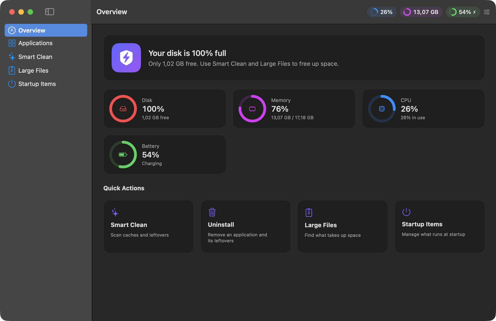

<p align="center">
  
</p>

<h1 align="center">MacErase</h1>

<p align="center">
  A small, fast, native macOS app that removes apps <em>and everything they leave behind</em>,<br>
  frees disk space safely, and puts live system widgets in the corner of your window.
</p>

<p align="center">
  
</p>

## Why MacErase

- **Safe by design.** Uninstalling moves everything to the Trash and offers **Undo**. Nothing personal is selected by default.
- **Light.** Pure SwiftUI/AppKit, no third‑party dependencies, no background daemon. Sampling runs only while the window is visible.
- **Honest.** No fake "health score", no "RAM cleaner", no telemetry, no network access.

## Features

| | |
|---|---|
| **Uninstall apps** | Lists every app in `/Applications` and `~/Applications`, finds leftovers (Application Support, Caches, Preferences, Containers, Group Containers, Logs, Saved State, LaunchAgents and `/Library` counterparts) and removes them in one go. **Drag an `.app` onto the window** to start. |
| **Smart Clean** | App caches, logs, Xcode artifacts, developer caches, iOS backups and the Trash. Only regenerable caches are selected by default; every item can be excluded. |
| **Large Files** | Finds big files in your home folders; move them to the Trash after review. |
| **Startup Items** | Shows LaunchAgents/Daemons and removes user ones. |
| **Widgets** | CPU, memory, disk, battery, network and clock pills in the top‑right of the window; toggle and reorder them. Optional menu‑bar item. |
| **Keyboard** | ⌘1–⌘5 switch sections, ⌘F search, ⌘R rescan, ⌘⌫ remove. |
| **Languages** | English and Türkçe, following your system language. |

## Install

Download `MacErase.zip` from the [latest release](../../releases/latest), unzip, and move **MacErase.app** to `/Applications`.

The build is ad‑hoc signed (not notarized). On first launch macOS may block it: right‑click the app → **Open**, or run:

```bash
xattr -dr com.apple.quarantine /Applications/MacErase.app
```

Requires macOS 14 or later.

### Build from source

```bash
git clone https://github.com/kuarezma/MacErase.git
cd MacErase
Scripts/build_app.sh        # → build/MacErase.app
swift test                  # unit tests
```

## Permissions

MacErase is not sandboxed because it has to look into other apps' folders. It never sends data anywhere.

- **Full Disk Access** is optional and only needed to read the Trash (System Settings → Privacy & Security).
- Removing root‑owned leftovers asks for your administrator password through the standard macOS prompt. These items are **not** moved to the Trash and are unchecked by default.

## How leftover matching works

An item is considered a leftover only if its name is the app's bundle ID, the ID plus one word (a helper or storage file), or a `group.<id>` / `<TeamID>.<id>` container. Names owned by another installed app, shared vendor folders (e.g. `Google`) and deeper IDs such as `com.vendor.app.for.testing` are skipped. See `Sources/MacErase/Core/AppScanner.swift` and its tests.

## Contributing

Issues and pull requests are welcome. Please run `swift test` before opening a PR. Deleting files is the sensitive part of this project: changes to matching or removal code need a test.

## License

[MIT](LICENSE)
